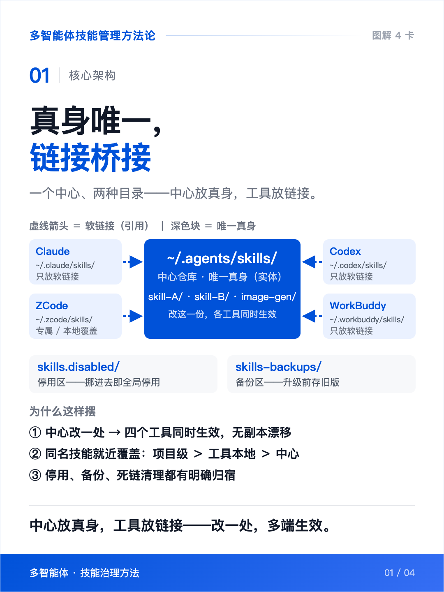
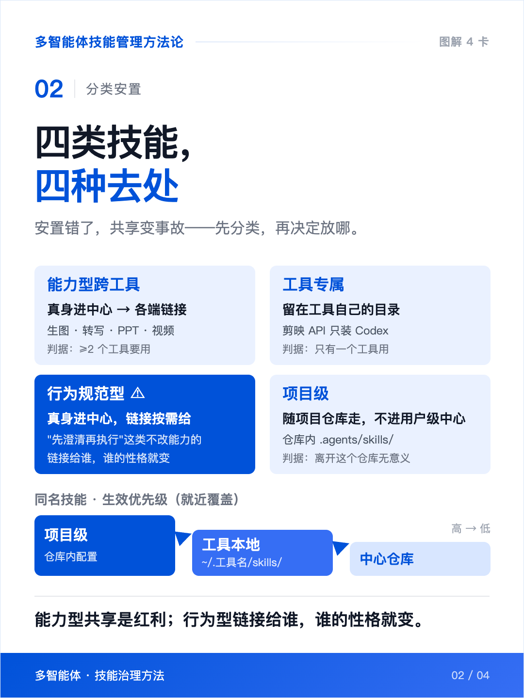
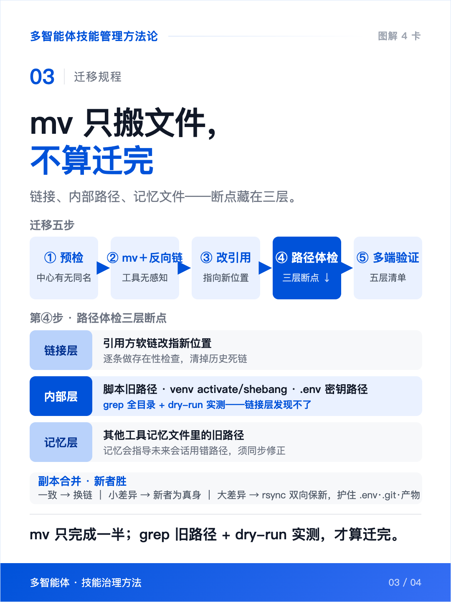
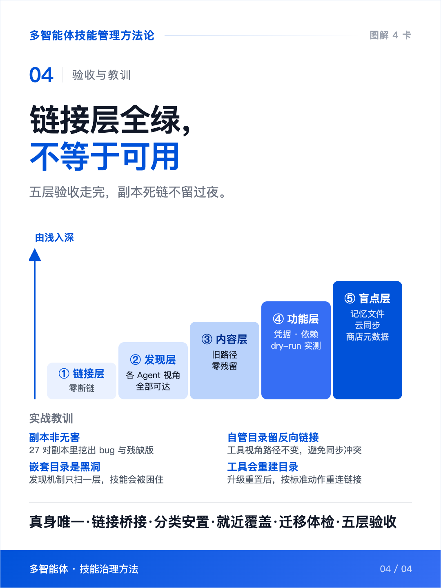
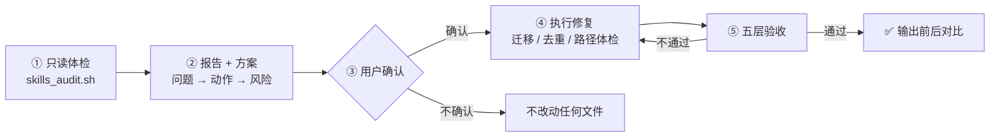
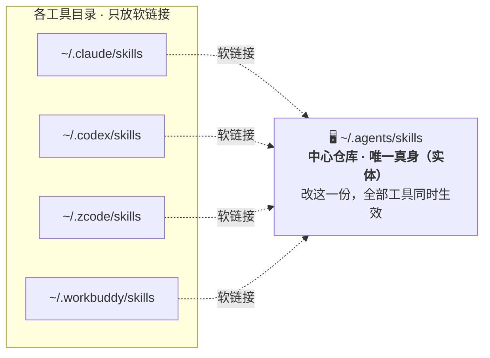

<div align="center">

# 🩺 skills-doctor

**真身唯一 · 软链接桥接**
**让几十个技能在所有 AI Agent 之间：改一处、处处生效**

*Audit, deduplicate & consolidate AI-agent skills into a single source of truth.*

[](LICENSE)


[](https://github.com/Anna-YC/skills-doctor/stargazers)

**安装 · 一条命令**

```bash
git clone --depth 1 https://github.com/Anna-YC/skill-organizer ~/.agents/skills/skill-organizer
```

兼容 ZCode（原生）· Claude Code · Codex · WorkBuddy 等一切带 skills 目录的 Agent

</div>

---

## 为什么需要它

如果你同时使用多个 AI 编程工具，技能目录几乎必然出现这四种病：

| 病症 | 后果 |
|---|---|
| 📦 **同一技能装 N 份** | 每个工具一份，改一个 bug 要改五处 |
| 🧬 **副本悄悄漂移** | 一份改了另一份没改，工具行为开始不一致 |
| 🔗 **死链与坏路径** | 技能一搬家，内部写死的路径全断 |
| 🕳️ **嵌套黑洞** | 发现机制只扫一层，多套一层的技能永远不可见 |

skills-doctor 用一套经过实战验证的架构把它们治好：**跨工具技能的真身只留一份在 `~/.agents/skills/`，其余工具目录只放软链接。**

---

## 👀 一眼看懂 · 图解 4 卡

> 点击任意一张可放大。图为方法论全貌：架构 → 分类 → 操作 → 验收。

<table>
<tr>
<td width="50%">

<a href="assets/cards/skills_method_01.png"></a>
<p align="center"><b>01 · 核心架构</b> — 一个中心、两种目录</p>

</td>
<td width="50%">

<a href="assets/cards/skills_method_02.png"></a>
<p align="center"><b>02 · 分类安置</b> — 四类技能，四种去处</p>

</td>
</tr>
<tr>
<td width="50%">

<a href="assets/cards/skills_method_03.png"></a>
<p align="center"><b>03 · 迁移规程</b> — mv 只搬文件，不算迁完</p>

</td>
<td width="50%">

<a href="assets/cards/skills_method_04.png"></a>
<p align="center"><b>04 · 验收与教训</b> — 链接层全绿 ≠ 可用</p>

</td>
</tr>
</table>

---

## ⚙️ 工作流程



**默认只读，动手必经确认**——这是写死在 SKILL.md 里的铁律。

---

## 🎯 目标架构



---

## 🚀 快速使用

**1️⃣ 直接跑只读体检脚本**（不改任何文件）：

```bash
bash ~/.agents/skills/skills-doctor/scripts/skills_audit.sh
```

**2️⃣ 或者对 Agent 说任意一句**：

> - 「帮我体检一下技能目录」
> - 「运行 skill-organizer / skills-doctor，看看我的 skills 有没有问题」
> - 「把这些工具里的技能去重、整理到 .agents」

**3️⃣ 检出的六类问题**：环境盘点 · 断链 · 同名实体副本 · 嵌套不可见技能 · 缺 SKILL.md 条目 · 硬编码绝对路径

<details>
<summary><b>🛡️ 安全边界（点击展开）</b></summary>

- 脚本**只读**，不改任何文件
- 所有 `mv` / `rm` / `rsync` 均需**逐项确认**
- 拿不准的技能进 `skills.disabled/` 存档区，**不做删除**
- 合并去重时保护 `.env` 密钥、`.git` 历史、生成产物
- 工具自管目录（如 cc-switch）收编真身后留**反向软链接**，不破坏工具自身管理

</details>

---

## ✅ 五层验收标准

修完不算完，五层全过才算完：

| 层 | 验什么 | 通过标准 |
|:---:|---|---|
| 1 | 🔗 链接层 | 各工具目录零断链 |
| 2 | 🔍 发现层 | 模拟每个 Agent 视角，技能全部可达 |
| 3 | 📝 内容层 | 旧路径 grep 零残留 |
| 4 | 🧪 功能层 | 关键技能 `--help` / `--dry-run` 实测通过 |
| 5 | 🕸️ 盲点层 | 记忆文件、云同步、商店元数据无旧路径 |

> 实战教训：**链接层全绿 ≠ 技能可用**——技能内部写死的 venv 路径、API 密钥路径、其他工具记忆文件里的旧路径，软链接机制一个都发现不了。

---

## 📚 方法论

<div align="center">

### 真身唯一 · 链接桥接 · 分类安置 · 就近覆盖 · 迁移体检 · 五层验收

</div>

完整原理与操作手册（含 27 对副本去重、40+ 处路径修复的实战案例）：

| 文档 | 内容 |
|---|---|
| [references/methodology.md](references/methodology.md) | 方法论全文：为什么这样做 |
| [references/migration-playbook.md](references/migration-playbook.md) | 迁移/去重 SOP：怎么做的细节与坑 |
| [references/audit-checklist.md](references/audit-checklist.md) | 五层验收清单：怎么算做完 |

## License

MIT © 2026 [Anna-YC](https://github.com/Anna-YC)
